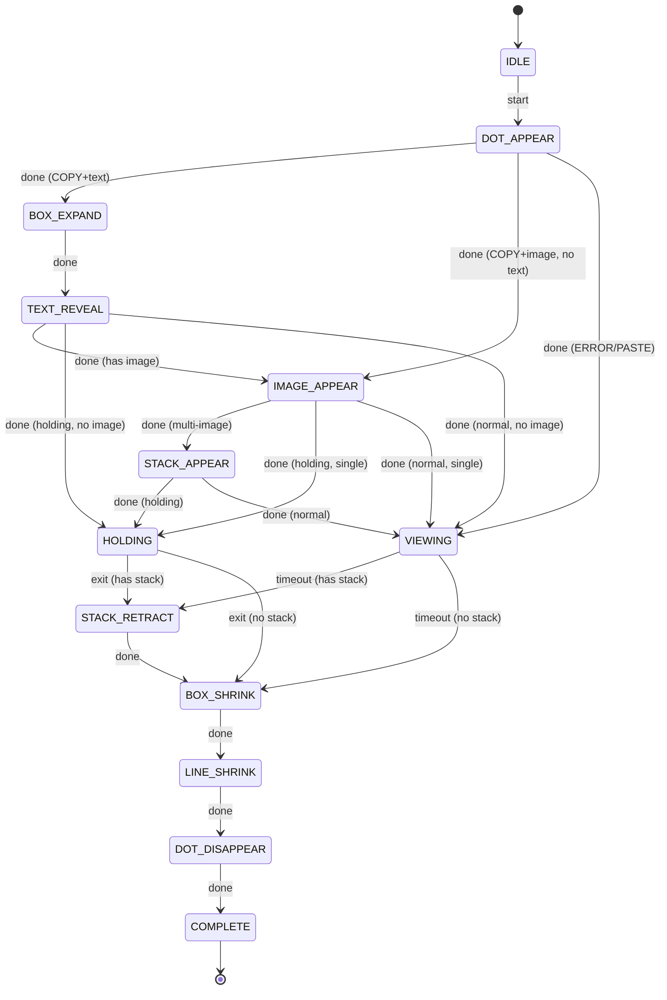

# C++ 混合重构计划

> 状态：规划中，暂不执行  
> 创建时间：2026-06-15

## 背景

当前 Dose Ctrl+C 全部使用 Python + PySide6 实现。对于核心高频模块，C++ 能带来明显收益，但需要权衡开发成本与部署复杂度。

## 收益分析

| 模块 | 当前瓶颈 | C++ 收益 | 优先级 |
|------|---------|---------|-------|
| 图片像素化/缩放 | QImage.scaled 频繁调用 | ★★★★★ 极大减少内存拷贝与延迟 | **高** |
| 剪贴板 MIME 解析 | 多次 MIME 查询、base64 解码 | ★★★★ 减少 GIL 竞争，加速解码 | **高** |
| 弹簧物理动画 | 每帧计算，Python 函数调用开销 | ★★★ 数值计算快但帧率已够 | 中 |
| 全局热键监听 | keyboard 库后台线程 | ★★ 替换成本高但更稳定 | 低 |
| 系统托盘 | PySide6 QSystemTrayIcon | ★ 无明显瓶颈 | 无 |

## 推荐方案：pybind11 混合扩展

### 架构

```
dose-ctrlc/
├── cpp_core/                    # C++ 源码
│   ├── CMakeLists.txt
│   ├── src/
│   │   ├── image_processor.cpp   # 像素化、缩放、base64 解码
│   │   ├── clipboard_parser.cpp  # MIME 解析、HTML  提取
│   │   └── spring_physics.cpp    # 弹簧缓动计算
│   └── include/
│       ├── image_processor.h
│       ├── clipboard_parser.h
│       └── spring_physics.h
├── binding/                      # pybind11 绑定
│   └── core_bindings.cpp
├── core/
│   ├── clipboard_monitor.py      # 保留，调用 C++ 加速函数
│   └── mouse_tracker.py
└── ui/
    └── feedback_widget.py        # 保留，QPainter 调用 C++ 预处理数据
```

### C++ 核心模块设计

#### 1. ImageProcessor

```cpp
// image_processor.h
#pragma once
#include <QImage>
#include <vector>
#include <string>

class ImageProcessor {
public:
    static QImage pixelate(const QImage& src, int blockSize);
    static QImage fastScale(const QImage& src, int targetSize);
    static QImage fromBase64(const std::string& b64Data);
    static QImage fromDataUri(const std::string& uri);
    using ImageCallback = std::function<void(QImage)>;
    static void fetchHttpImage(const std::string& url, int timeoutMs, int maxBytes, ImageCallback cb);
};
```

#### 2. ClipboardParser

```cpp
// clipboard_parser.h
#pragma once
#include <QImage>
#include <QString>
#include <QList>
#include <QUrl>
#include <vector>
#include <string>

struct ClipboardPayload {
    std::string text;
    std::vector<QImage> images;
    int imageCount = 0;
};

class ClipboardParser {
public:
    static ClipboardPayload extract(const QMimeData* mimeData);
    static std::string extractImgSrc(const std::string& html);
    static std::string normalizePath(const std::string& text);
};
```

#### 3. SpringPhysics

```cpp
// spring_physics.h
#pragma once

class SpringPhysics {
public:
    SpringPhysics(double stiffness, double damping);
    double step(double dt);
    double value() const;
    void   setTarget(double target);
    void   reset(double initialValue);
private:
    double stiffness_, damping_;
    double value_, velocity_, target_;
};
```

### 构建流程

```bash
cd dose-ctrlc/cpp_core
mkdir build && cd build
cmake .. -G "Visual Studio 17 2022" -A x64 ^
    -DPython_ROOT="C:/Python312" ^
    -Dpybind11_DIR="C:/Python312/Lib/site-packages/pybind11/share/cmake/pybind11"
cmake --build . --config Release
cp Release/_dose_ctrlc_core.pyd ../../
```

### PyInstaller 打包适配

```spec
a = Analysis(
    ['main.py'],
    datas=[('config.py', '.'), ('_dose_ctrlc_core.pyd', '.')],
    binaries=[('_dose_ctrlc_core.pyd', '.')],
    ...
)
```

注意事项：
- `.pyd` 文件必须与打包用的 Python 版本/架构一致
- 运行时需要匹配的 VC++ Runtime，PyInstaller 通常自动收集
- CI 环境需要固定 Python 版本 + 编译工具链版本

### CMakeLists.txt 模板

```cmake
cmake_minimum_required(VERSION 3.16)
project(dose_ctrlc_core LANGUAGES CXX)
set(CMAKE_CXX_STANDARD 17)
set(CMAKE_CXX_STANDARD_REQUIRED ON)
find_package(pybind11 REQUIRED)
find_package(Qt6 REQUIRED COMPONENTS Core Gui)
pybind11_add_module(_dose_ctrlc_core
    binding/core_bindings.cpp
    src/image_processor.cpp
    src/clipboard_parser.cpp
    src/spring_physics.cpp
)
target_link_libraries(_dose_ctrlc_core PRIVATE Qt6::Core Qt6::Gui)
target_include_directories(_dose_ctrlc_core PRIVATE include)
```

## 全 C++ Qt 方案（远期备选）

- **框架**：Qt 6 + CMake
- **部署**：`windeployqt` + NSIS 安装器
- **优势**：单进程、无 GIL、启动更快、无 PyInstaller 坑
- **代价**：开发周期长、跨版本编译维护成本高

## 实施路线

| 阶段 | 内容 | 预计时间 |
|------|------|---------|
| Phase 1 | 抽取 ImageProcessor 为 C++ 扩展 | 2-3 天 |
| Phase 2 | ClipboardParser C++ 化 | 2 天 |
| Phase 3 | SpringPhysics C++ 化（可选） | 1 天 |
| Phase 4 | CI 自动编译 .pyd + 集成测试 | 1-2 天 |
| Phase 5 | PyInstaller 打包验证 | 1 天 |

## 风险

1. **版本耦合**：.pyd 与 Python 版本强绑定，发布需多版本编译
2. **VC++ Runtime**：用户机器可能缺少对应 Runtime，需在安装器中包含
3. **调试复杂度**：C++ 段崩溃时 Python 端无有效 traceback
4. **CI 成本**：需维护 Windows + macOS（如需）编译环境

---

## UI 架构重构

> 状态：规划中，优先级高于 C++ 化（架构问题是性能问题的根源）  
> 更新时间：2026-06-17

### 问题分析

当前 `ui/feedback_widget.py` 有 **689 行**，是项目中最大的单文件，存在严重的"上帝类"问题：

| 问题 | 具体表现 | 影响 |
|------|---------|------|
| **职责过载** | FeedbackWidget 同时负责：状态机管理、属性动画引擎、文字解码动画、图片像素化动画、堆叠层动画、所有绘制逻辑 | 修改任一功能需理解全部代码 |
| **动画系统重复造轮子** | 自建 `_start_property_animation` / `_animation_tick`，与 Qt QPropertyAnimation 功能重叠 | 维护成本高，缺少暂停/反转/组合能力 |
| **绘制逻辑臃肿** | `paintEvent` + `_draw_main_image` + `_draw_stack_layer` 混合布局计算、坐标变换、像素化、裁剪 | 难以单独测试和调试 |
| **ScrambleText 重复实现** | `ui/scramble_text.py` 已是独立组件，但 FeedbackWidget 内部又自建 scramble 逻辑 | 代码冗余，改一处忘改另一处 |
| **多定时器难以维护** | 6 个 QTimer 生命周期交错 | 容易出现定时器泄漏、状态竞争 |
| **状态机分散** | 状态转换逻辑分散在 4 处方法中 | 难以纵观完整状态转换图 |

### 重构目标

1. **单一职责**：每个类/文件只负责一个视觉元素或一个关注点
2. **组件化**：每个视觉元素是独立 QWidget，可独立测试
3. **状态机集中**：状态转换逻辑集中在一处，可生成状态转换图
4. **动画统一**：使用统一动画引擎，减少手写定时器
5. **消除重复**：复用已有 ScrambleText 组件

### 重构后的目录结构

```
ui/
├── __init__.py
├── feedback_widget.py        # 轻量容器：窗口属性 + 子组件编排（~100 行）
├── animation/
│   ├── __init__.py
│   ├── state_machine.py      # AnimationStateMachine：状态定义 + 转换表
│   ├── property_engine.py    # PropertyEngine：统一属性动画引擎
│   └── spring_ease.py        # 弹簧缓动函数（从 FeedbackWidget 抽取）
├── components/
│   ├── __init__.py
│   ├── dot_renderer.py       # DotRenderer：圆点 + 辉光绘制
│   ├── content_box.py        # ContentBox：黑色透明框 + 边线绘制
│   ├── scramble_text.py      # ScrambleText：文字解码特效（已有，复用）
│   ├── image_renderer.py     # ImageRenderer：主图像素化 + 圆角裁剪 + 收缩动画
│   └── stack_layer.py        # StackLayer：堆叠层弹出/回收动画
└── layouts/
    └── feedback_layout.py    # FeedbackLayout：各子组件坐标计算 + 动画时序编排
```

### 组件详细设计

#### 1. FeedbackWidget（轻量容器）

**职责**：仅管理窗口属性 + 子组件生命周期编排，不再包含任何绘制逻辑

```python
class FeedbackWidget(QWidget):
    """纯容器 — 窗口 flags、位置、子组件编排"""
    animation_complete = Signal()

    def __init__(self, feedback_type, text, images, image_count, holding_mode):
        # 1. 设置窗口 flags（FramelessWindowHint | StaysOnTop | Tool）
        # 2. 创建 AnimationStateMachine
        # 3. 创建 PropertyEngine
        # 4. 创建子组件：DotRenderer, ContentBox, ScrambleText, ImageRenderer, StackLayer
        # 5. 创建 FeedbackLayout 管理子组件坐标
        # 6. 连接状态机信号 → 各组件的 show/hide/animate 槽

    def start_animation(self): ...
    def start_exit(self): ...
    def update_images(self, images, image_count): ...
    def move_to_position(self, x, y): ...
    def stop(self): ...
```

**关键变化**：
- 删除 `paintEvent` — 所有绘制由子组件各自负责
- 删除 6 个 QTimer — 由 `PropertyEngine` 统一管理
- 删除 `_scramble_tick` / `_image_scramble_tick` / `_stack_anim_tick` — 由各组件内部处理

#### 2. AnimationStateMachine（状态机）

**职责**：集中定义所有状态和转换规则，替代分散在 4 处方法中的转换逻辑

```python
class AnimationState(Enum):
    IDLE = auto()
    DOT_APPEAR = auto()
    BOX_EXPAND = auto()
    TEXT_REVEAL = auto()
    IMAGE_APPEAR = auto()
    STACK_APPEAR = auto()
    VIEWING = auto()
    HOLDING = auto()
    STACK_RETRACT = auto()
    BOX_SHRINK = auto()
    LINE_SHRINK = auto()
    DOT_DISAPPEAR = auto()
    COMPLETE = auto()

class AnimationStateMachine(QObject):
    state_changed = Signal(AnimationState)
    animation_requested = Signal(str, float, float, int, object)  # prop, start, end, duration, easing

    # 转换表：{(当前状态, 条件) → (下一状态, 动作)}
    TRANSITIONS = {
        (IDLE, 'start'):         (DOT_APPEAR, 'animate_dot_appear'),
        (DOT_APPEAR, 'done'):    (BOX_EXPAND, 'animate_box_expand'),     # COPY 有文字
                                  # → IMAGE_APPEAR (COPY 无文字有图片)
                                  # → VIEWING (ERROR/PASTE)
        (BOX_EXPAND, 'done'):    (TEXT_REVEAL, 'start_scramble'),
        (TEXT_REVEAL, 'done'):   (IMAGE_APPEAR, 'animate_image'),        # 有图片
                                  # → HOLDING / VIEWING (无图片)
        (IMAGE_APPEAR, 'done'):  (STACK_APPEAR, 'animate_stack'),        # 多图
                                  # → HOLDING / VIEWING (单图)
        (STACK_APPEAR, 'done'):  (HOLDING, 'start_holding_timer'),       # holding 模式
                                  # → VIEWING, 'start_view_timer'),      # 普通模式
        (VIEWING, 'timeout'):    (STACK_RETRACT, 'retract_stack'),       # 有堆叠
                                  # → BOX_SHRINK, 'animate_box_shrink'), # 无堆叠
        (HOLDING, 'exit'):       (STACK_RETRACT, 'retract_stack'),       # 有堆叠
                                  # → BOX_SHRINK, 'animate_box_shrink'), # 无堆叠
        (STACK_RETRACT, 'done'): (BOX_SHRINK, 'animate_box_shrink'),
        (BOX_SHRINK, 'done'):    (LINE_SHRINK, 'animate_line_shrink'),
        (LINE_SHRINK, 'done'):   (DOT_DISAPPEAR, 'animate_dot_disappear'),
        (DOT_DISAPPEAR, 'done'): (COMPLETE, 'emit_complete'),
    }
```

**优势**：
- 状态转换图一目了然，可自动生成 Mermaid 图
- 新增状态只需在 TRANSITIONS 表中添加一行
- 不再有 `_on_animation_finished` / `_advance_state` / `_enter_image_or_viewing` 等分散方法

#### 3. PropertyEngine（统一动画引擎）

**职责**：替代 6 个手写 QTimer + `_start_property_animation` / `_animation_tick`，提供声明式动画 API

```python
class PropertyEngine(QObject):
    """统一属性动画引擎 — 管理所有活跃动画的插值"""
    tick = Signal()  # 每帧触发，通知所有组件 repaint

    def __init__(self):
        self._timer = QTimer(interval=16)  # 单一定时器，~60fps
        self._active_anims: dict[str, AnimDescriptor] = {}

    def animate(self, prop: str, start: float, end: float,
                duration: int, easing: QEasingCurve = None,
                on_finished: callable = None) -> None: ...

    def cancel(self, prop: str) -> None: ...
    def cancel_all(self) -> None: ...
    def get_value(self, prop: str) -> float: ...

    def _tick(self):
        """单定时器驱动所有活跃动画"""
        now = time.time() * 1000
        for prop, desc in list(self._active_anims.items()):
            raw = min((now - desc.start_time) / desc.duration, 1.0)
            eased = desc.easing.valueForProgress(raw)
            desc.current = desc.start + (desc.end - desc.start) * eased
            if raw >= 1.0:
                desc.current = desc.end
                del self._active_anims[prop]
                if desc.on_finished:
                    desc.on_finished()
        self.tick.emit()
        if not self._active_anims:
            self._timer.stop()

@dataclass
class AnimDescriptor:
    start: float
    end: float
    duration: int
    easing: QEasingCurve
    start_time: float
    current: float
    on_finished: callable = None
```

**与 QPropertyAnimation 的对比**：

| 维度 | PropertyEngine（自建） | QPropertyAnimation |
|------|----------------------|-------------------|
| 多属性并行 | ✅ 单定时器驱动多属性 | ❌ 每个属性需独立实例 |
| 回调控制 | ✅ on_finished 直接回调 | ⚠️ 需 Signal/Slot 连接 |
| 与状态机集成 | ✅ 直接在转换表中指定 | ⚠️ 需额外编排逻辑 |
| 学习成本 | 低（项目内 API） | 中（Qt 动画组概念） |
| 暂停/反转 | ❌ 暂不支持 | ✅ 原生支持 |

**决策**：采用自建 `PropertyEngine`，因为当前动画场景是严格顺序的、不需要暂停/反转，单定时器方案更轻量且与状态机集成更自然。如果未来需要复杂动画编排，再考虑迁移到 QPropertyAnimation。

#### 4. DotRenderer（圆点组件）

```python
class DotRenderer(QWidget):
    """圆点 + 辉光 — 独立 QWidget"""
    def __init__(self, color: QColor, radius: int, parent=None): ...
    def set_scale(self, scale: float): ...     # 由 PropertyEngine 驱动
    def paintEvent(self, event): ...            # 辉光 + 实心圆
```

#### 5. ContentBox（内容框组件）

```python
class ContentBox(QWidget):
    """黑色透明框 + 左边线 — 独立 QWidget"""
    def __init__(self, parent=None): ...
    def set_width(self, width: float): ...     # 由 PropertyEngine 驱动 box_width
    def set_height(self, height: float): ...   # 由 PropertyEngine 驱动 box_height
    def set_opacity(self, opacity: float): ... # 由 PropertyEngine 驱动 box_opacity
    def paintEvent(self, event): ...            # 渐变背景 + 左边线
```

**从 `FeedbackWidget` 迁移的绘制逻辑**：
- `paintEvent` 中 `self._feedback_type == COPY and self._box_width > 0` 分支
- `QLinearGradient` 渐变背景（黑→透明）
- 左边线绘制（`COLORS['border']`）
- `CompositionMode_DestinationOver` 合成模式

#### 6. ScrambleText（文字解码组件 — 复用已有）

**当前状态**：`ui/scramble_text.py` 已存在，但 `FeedbackWidget` 内部又自建了 `_scramble_tick` 逻辑

**重构方式**：
- 删除 `FeedbackWidget._scramble_tick` / `_scramble_timer` / `_scramble_start_time`
- 直接实例化 `ScrambleText` 组件，嵌入 `ContentBox` 内部
- `ScrambleText` 自管定时器和动画，完成后发 Signal 通知状态机

```python
# 在 ContentBox 内部持有 ScrambleText
class ContentBox(QWidget):
    def __init__(self, parent=None):
        ...
        self._text_widget = ScrambleText(parent=self)

    def set_text(self, text: str): ...
    def start_scramble(self): ...              # 委托给 ScrambleText
    # scramble_complete Signal → 状态机 TEXT_REVEAL done
```

#### 7. ImageRenderer（主图组件）

```python
class ImageRenderer(QWidget):
    """主图像素化渐显 + 圆角裁剪 + 收缩退场 — 独立 QWidget"""
    def __init__(self, parent=None): ...
    def set_image(self, image: QImage): ...    # 主图数据
    def set_scramble_progress(self, p: float): ...  # 像素化进度 0→1
    def set_vanish_ratio(self, ratio: float): ...   # 收缩比例（退场时 1→0）
    def paintEvent(self, event): ...            # 像素化 + 圆角裁剪 + 收缩
```

**从 `FeedbackWidget` 迁移的绘制逻辑**：
- `_draw_main_image` 全部逻辑
- 像素化计算：`block = max(5, int(40 * ((1.0 - progress) ** 2)))`
- 圆角裁剪：`QPainterPath.addRoundedRect`
- 收缩动画：`draw_size = max(2, int(base_size * vanish_ratio))`
- 占位框（图片未加载时）

**像素化动画自管**：
- 内部持有 `QTimer`（40ms 间隔），驱动 `_image_scramble_progress` 从 0→1
- 不再由 `FeedbackWidget._image_scramble_timer` 驱动

#### 8. StackLayer（堆叠层组件）

```python
class StackLayer(QWidget):
    """堆叠层弹出/回收 — 独立 QWidget"""
    def __init__(self, layer_idx: int, parent=None): ...
    def set_progress(self, progress: float): ...  # 0=隐藏, 1=完全展开
    def set_image(self, image: QImage): ...       # 可选：真实缩略图
    def paintEvent(self, event): ...               # 旋转 + 偏移 + 圆角背景 + 可选缩略图
```

**从 `FeedbackWidget` 迁移的绘制逻辑**：
- `_draw_stack_layer` 全部逻辑
- 旋转圆心计算（主图右下角）
- `QTransform` 旋转 + 偏移
- 根据 `show_real_thumbnails` 决定是否渲染真实缩略图

**堆叠动画自管**：
- 内部持有 `QTimer`（16ms 间隔），驱动 `_stack_progress`
- 弹出用弹簧缓动（`spring_ease`），回收用 easeIn
- 完成后发 Signal 通知状态机

#### 9. FeedbackLayout（布局编排）

```python
class FeedbackLayout:
    """非 QLayout — 纯坐标计算器，由 FeedbackWidget 调用"""
    def __init__(self, config: dict): ...       # SIZES + IMAGE_STACK 配置

    def calculate(self, dot_scale, box_width, box_height,
                  has_image, image_count) -> dict:
        """返回各组件的 (x, y, w, h) 字典"""
        return {
            'dot': (dot_cx, dot_cy, dot_radius * dot_scale),
            'box': (box_x, box_y, box_w, box_h),
            'image': (img_x, img_y, img_size),
            'stack_layers': [(sx, sy, size), ...],
        }
```

**设计决策**：不使用 QLayout，因为动画窗口的子组件位置由动画参数实时驱动，QLayout 的约束系统会干扰动画坐标。

### 状态转换图（Mermaid）



### UI 重构实施路线

| 阶段 | 内容 | 依赖 | 预计时间 | 风险 |
|------|------|------|---------|------|
| **Step 1** | 抽取 `spring_ease.py` — 纯函数，零依赖 | 无 | 0.5 天 | 极低 |
| **Step 2** | 抽取 `state_machine.py` — 状态定义 + 转换表 | 无 | 1 天 | 低 |
| **Step 3** | 实现 `property_engine.py` — 统一动画引擎 | Step 1 | 1 天 | 中（需验证多属性并行） |
| **Step 4** | 抽取 `dot_renderer.py` — 最简单组件，验证架构 | Step 3 | 0.5 天 | 低 |
| **Step 5** | 抽取 `content_box.py` + 复用 `scramble_text.py` | Step 3 | 1 天 | 中（ScrambleText 集成） |
| **Step 6** | 抽取 `image_renderer.py` — 像素化 + 裁剪 | Step 3 | 1 天 | 中（像素化逻辑复杂） |
| **Step 7** | 抽取 `stack_layer.py` — 堆叠层动画 | Step 1, 3 | 1 天 | 中（旋转+偏移计算） |
| **Step 8** | 实现 `feedback_layout.py` — 坐标计算 | Step 4-7 | 0.5 天 | 低 |
| **Step 9** | 重写 `feedback_widget.py` — 纯容器 + 编排 | Step 2-8 | 1 天 | 高（集成测试） |
| **Step 10** | 回归测试 — 所有动画序列验证 | Step 9 | 1 天 | 高（视觉一致性） |

**总预计时间**：8-9 天

**关键里程碑**：
- Step 3 完成后 → 可独立测试 PropertyEngine，确认单定时器方案可行
- Step 4 完成后 → 验证组件化架构（DotRenderer 作为第一个组件化试点）
- Step 9 完成后 → 完整集成，旧 `feedback_widget.py` 可完全替换

### UI 重构风险

1. **视觉一致性**：拆分后各组件独立绘制，需确保合成效果与原版一致（特别是透明度叠加、裁剪路径）
2. **性能回归**：多个 QWidget 的 paintEvent 分别调用，可能比单次 paintEvent 略慢（需实测）
3. **Z-Order**：子组件的堆叠顺序需显式管理（`raise_()` / `lower_()`），原版由绘制顺序保证
4. **窗口尺寸**：多个子组件的几何需协调，FeedbackLayout 的计算必须覆盖所有状态

---

## 跨平台扩展规划

> 状态：规划中，优先级低于 UI 重构，可与 C++ 化并行  
> 更新时间：2026-06-17

### 当前平台绑定分析

| 绑定点 | 当前实现 | 跨平台状态 | 适配方案 |
|--------|---------|-----------|---------|
| 全局热键监听 | `keyboard.add_hotkey('ctrl+c')` | ❌ Windows 专用 hook | 抽象为 `HotkeyBackend` 接口 |
| 剪贴板读取 | `QGuiApplication.clipboard()` | ✅ Qt 跨平台 | 无需改动 |
| 鼠标位置获取 | `QCursor.pos()` | ✅ Qt 跨平台 | 无需改动 |
| 系统托盘 | `QSystemTrayIcon` | ✅ Qt 跨平台 | 无需改动 |
| Windows App ID | `ctypes.windll.shell32` | ❌ Windows 专用 | 条件编译，仅 Windows 调用 |
| 剪贴板文本回退 | `pyperclip.paste()` | ⚠️ 跨平台但依赖原生工具 | 保留作为回退，主路径用 Qt |
| 路径规范化 | Windows/Unix 路径正则 | ⚠️ 已部分支持 | 补充 macOS 特殊路径 |

**结论**：核心绑定点只有 **全局热键** 和 **Windows App ID** 两处，其余已跨平台。

### 跨平台架构设计

```
core/
├── clipboard_monitor.py      # 保留：Qt 部分已跨平台，调用 platform backend
├── mouse_tracker.py          # 保留：已跨平台
└── platform/
    ├── __init__.py           # 工厂函数：detect_platform() → 返回对应 backend
    ├── base.py               # 抽象基类：HotkeyBackend, SystemIntegration
    ├── windows_backend.py    # Windows: keyboard 库 + ctypes
    ├── macos_backend.py      # macOS: pyobjc + NSWorkspace
    └── linux_backend.py      # Linux: evdev / xdotool
```

### 抽象接口定义

```python
# core/platform/base.py
from abc import ABC, abstractmethod
from typing import Callable

class HotkeyBackend(ABC):
    """全局热键监听后端 — 平台无关接口"""

    @abstractmethod
    def register_hotkey(self, key_combo: str, callback: Callable[[], None]) -> None:
        """注册全局热键
        key_combo: 'ctrl+c', 'ctrl+v', 'cmd+c' (macOS) 等
        callback: 热键触发时的回调（在后台线程中调用，需通过 Signal 转发到主线程）
        """
        ...

    @abstractmethod
    def unregister_all(self) -> None:
        """注销所有已注册的热键"""
        ...

    @abstractmethod
    def is_supported(self) -> bool:
        """当前平台是否支持此后端"""
        ...


class SystemIntegration(ABC):
    """系统集成 — 平台特定功能"""

    @abstractmethod
    def set_app_id(self, app_id: str) -> None:
        """设置应用程序 ID（Windows: AppUserModelID, macOS: 无需, Linux: .desktop 文件）"""
        ...

    @abstractmethod
    def get_platform_name(self) -> str:
        """返回平台标识：'windows' / 'macos' / 'linux'"""
        ...
```

### 工厂函数

```python
# core/platform/__init__.py
import sys

def create_hotkey_backend() -> HotkeyBackend:
    """根据当前平台自动选择热键后端"""
    platform = detect_platform()
    if platform == 'windows':
        from .windows_backend import WindowsHotkeyBackend
        return WindowsHotkeyBackend()
    elif platform == 'macos':
        from .macos_backend import MacOSHotkeyBackend
        return MacOSHotkeyBackend()
    elif platform == 'linux':
        from .linux_backend import LinuxHotkeyBackend
        return LinuxHotkeyBackend()
    else:
        raise RuntimeError(f"Unsupported platform: {platform}")

def create_system_integration() -> SystemIntegration:
    platform = detect_platform()
    if platform == 'windows':
        from .windows_backend import WindowsSystemIntegration
        return WindowsSystemIntegration()
    elif platform == 'macos':
        from .macos_backend import MacOSSystemIntegration
        return MacOSSystemIntegration()
    elif platform == 'linux':
        from .linux_backend import LinuxSystemIntegration
        return LinuxSystemIntegration()
    else:
        raise RuntimeError(f"Unsupported platform: {platform}")

def detect_platform() -> str:
    if sys.platform == 'win32':
        return 'windows'
    elif sys.platform == 'darwin':
        return 'macos'
    elif sys.platform.startswith('linux'):
        return 'linux'
    else:
        return 'unknown'
```

### 各平台后端实现要点

#### Windows（当前已实现）

```python
# core/platform/windows_backend.py
import keyboard
import ctypes

class WindowsHotkeyBackend(HotkeyBackend):
    """基于 keyboard 库的 Windows 热键后端"""
    def register_hotkey(self, key_combo, callback):
        keyboard.add_hotkey(key_combo, callback, suppress=False)
    def unregister_all(self):
        keyboard.unhook_all_hotkeys()
    def is_supported(self):
        return sys.platform == 'win32'

class WindowsSystemIntegration(SystemIntegration):
    def set_app_id(self, app_id):
        ctypes.windll.shell32.SetCurrentProcessExplicitAppUserModelID(app_id)
    def get_platform_name(self):
        return 'windows'
```

#### macOS（待实现）

```python
# core/platform/macos_backend.py
# 依赖：pyobjc-framework-Quartz, pyobjc-framework-Cocoa

class MacOSHotkeyBackend(HotkeyBackend):
    """基于 pyobjc 的 macOS 热键后端
    实现方案：
    1. 使用 Quartz.CGEventTap 监听全局键盘事件
    2. 检测 Cmd+C / Cmd+V 组合键
    3. 回调通过 CFRunLoop 在主线程执行
    """
    def register_hotkey(self, key_combo, callback):
        # key_combo 映射：'ctrl+c' → Cmd+C (macOS)
        # 使用 CGEventTap 创建事件监听
        ...
    def unregister_all(self):
        # 移除 CGEventTap
        ...
    def is_supported(self):
        return sys.platform == 'darwin'
```

**macOS 特殊注意事项**：
- 热键是 `Cmd+C/V` 而非 `Ctrl+C/V`，需在 key_combo 映射层处理
- 需要辅助功能权限（Accessibility Permission），首次运行需引导用户授权
- `CGEventTap` 需在主线程的 `CFRunLoop` 中运行
- 剪贴板变化监听可用 `NSPasteboard.changeCount` 轮询（替代热键监听）

#### Linux（待实现）

```python
# core/platform/linux_backend.py
# 依赖：python-evdev 或 xdotool

class LinuxHotkeyBackend(HotkeyBackend):
    """基于 evdev 的 Linux 热键后端
    实现方案：
    1. 使用 evdev 监听 /dev/input/ 设备
    2. 检测 Ctrl+C / Ctrl+V 组合键
    3. 需要 uinput 权限或 sudo
    备选方案：xdotool + xbindkeys
    """
    def register_hotkey(self, key_combo, callback):
        ...
    def unregister_all(self):
        ...
    def is_supported(self):
        return sys.platform.startswith('linux')
```

**Linux 特殊注意事项**：
- Wayland 下 evdev 可能不可用，需考虑 X11/Wayland 双路径
- 需要 input 组权限或 udev 规则
- 无统一的热键 API，发行版差异大

### ClipboardMonitor 适配改造

当前 `ClipboardMonitor` 直接调用 `keyboard.add_hotkey`，需改为通过 backend 间接调用：

```python
# 改造前
keyboard.add_hotkey('ctrl+c', lambda: self._ctrl_c_triggered.emit(), suppress=False)

# 改造后
from core.platform import create_hotkey_backend
self._hotkey_backend = create_hotkey_backend()
self._hotkey_backend.register_hotkey('ctrl+c', lambda: self._ctrl_c_triggered.emit())
self._hotkey_backend.register_hotkey('ctrl+v', lambda: self._ctrl_v_triggered.emit())
```

### 跨平台实施路线

| 阶段 | 内容 | 依赖 | 预计时间 | 风险 |
|------|------|------|---------|------|
| **Phase 1** | 抽取 `core/platform/` 抽象层 + Windows 实现 | 无 | 1-2 天 | 低（仅重构，不改行为） |
| **Phase 2** | 改造 `ClipboardMonitor` 使用 backend | Phase 1 | 0.5 天 | 低 |
| **Phase 3** | macOS 适配（pyobjc + CGEventTap） | Phase 1 | 3-5 天 | 高（权限、CFRunLoop） |
| **Phase 4** | Linux 适配（evdev / xdotool） | Phase 1 | 2-3 天 | 中（权限、Wayland） |
| **Phase 5** | 跨平台 CI + 自动化测试 | Phase 2-4 | 2-3 天 | 中（环境配置） |

**Phase 1 是零风险重构**：仅将 `keyboard.add_hotkey` 调用移入 `WindowsHotkeyBackend`，行为完全不变。后续 Phase 2-4 可按需推进。

### 跨平台依赖清单

| 平台 | 依赖库 | 安装方式 | 大小影响 |
|------|--------|---------|---------|
| Windows | `keyboard` | `pip install keyboard` | ~50KB（已包含） |
| macOS | `pyobjc-framework-Quartz` | `pip install pyobjc-framework-Quartz` | ~2MB |
| macOS | `pyobjc-framework-Cocoa` | `pip install pyobjc-framework-Cocoa` | ~3MB |
| Linux | `evdev` | `pip install evdev` | ~100KB |
| Linux | `xdotool`（备选） | `apt install xdotool` | 系统包 |

**条件依赖策略**：在 `requirements.txt` 中使用平台标记：

```
keyboard>=0.13; sys_platform == 'win32'
pyobjc-framework-Quartz>=9.0; sys_platform == 'darwin'
pyobjc-framework-Cocoa>=9.0; sys_platform == 'darwin'
evdev>=1.6; sys_platform == 'linux'
```

### 跨平台风险

1. **macOS 辅助功能权限**：`CGEventTap` 需要用户手动授权，首次体验差
2. **Linux 权限模型**：evdev 需要 input 组权限，普通用户可能无法直接使用
3. **Wayland 兼容性**：Linux 桌面正在向 Wayland 迁移，evdev 在 Wayland 下行为不确定
4. **测试覆盖**：无法在 Windows 上测试 macOS/Linux 后端，需 CI 矩阵

---

## C++ 化与跨平台协同

> 状态：规划中，补充现有 C++ 计划的跨平台维度  
> 更新时间：2026-06-17

### 多平台 C++ 编译策略

现有 C++ 计划仅覆盖 Windows (MSVC)，需扩展为三平台编译：

| 平台 | 编译器 | Qt 版本 | pybind11 | 产物 | 修复工具 |
|------|--------|---------|----------|------|---------|
| Windows | MSVC 2022 | Qt 6.x | pip install | `_dose_ctrlc_core.pyd` | 无需 |
| macOS | Clang (Xcode) | Qt 6.x (brew) | pip install | `_dose_ctrlc_core.cpython-312-darwin.so` | `delocate` |
| Linux | GCC 11+ | Qt 6.x (apt) | pip install | `_dose_ctrlc_core.cpython-312-x86_64-linux-gnu.so` | `auditwheel` |

### GitHub Actions CI 矩阵

```yaml
# .github/workflows/build-core.yml
name: Build C++ Core
on: [push, pull_request]

jobs:
  build:
    strategy:
      matrix:
        include:
          - os: windows-latest
            python: '3.12'
            cmake_generator: 'Visual Studio 17 2022'
          - os: macos-latest
            python: '3.12'
            cmake_generator: 'Unix Makefiles'
          - os: ubuntu-latest
            python: '3.12'
            cmake_generator: 'Unix Makefiles'
    runs-on: ${{ matrix.os }}
    steps:
      - uses: actions/checkout@v4
      - uses: actions/setup-python@v5
        with:
          python-version: ${{ matrix.python }}
      - run: pip install pybind11 pytest
      - run: |
          # macOS: 安装 Qt
          if [ "$RUNNER_OS" == "macOS" ]; then brew install qt6; fi
          # Linux: 安装 Qt
          if [ "$RUNNER_OS" == "Linux" ]; then sudo apt install qt6-base-dev; fi
      - run: |
          cd cpp_core && mkdir build && cd build
          cmake .. -G "${{ matrix.cmake_generator }}" \
            -DPython_ROOT="${{ env.Python_ROOT }}" \
            -Dpybind11_DIR="$(python -c 'import pybind11; print(pybind11.get_cmake_dir())')"
          cmake --build . --config Release
      - uses: actions/upload-artifact@v4
        with:
          name: core-${{ matrix.os }}
          path: |
            cpp_core/build/Release/_dose_ctrlc_core.*
            cpp_core/build/_dose_ctrlc_core.*
```

### C++ 模块与跨平台抽象层的关系

```
┌─────────────────────────────────────────────────┐
│                  Python 层                       │
│  ┌──────────────┐  ┌──────────────────────────┐ │
│  │  UI (PySide6) │  │  core/                   │ │
│  │  跨平台 ✓     │  │  clipboard_monitor.py    │ │
│  │               │  │  mouse_tracker.py        │ │
│  └──────────────┘  │  platform/ (抽象层)       │ │
│                    │    ├── base.py (接口)      │ │
│                    │    ├── windows_backend.py  │ │
│                    │    ├── macos_backend.py    │ │
│                    │    └── linux_backend.py    │ │
│                    └──────────────────────────┘ │
├─────────────────────────────────────────────────┤
│                  C++ 层 (pybind11)               │
│  ┌─────────────────────────────────────────────┐│
│  │  ImageProcessor  │  ClipboardParser  │ Spring││
│  │  (跨平台 ✓)      │  (跨平台 ✓)       │ (跨平台)││
│  └─────────────────────────────────────────────┘│
└─────────────────────────────────────────────────┘
```

**关键原则**：
- **C++ 核心模块本身是跨平台的**：ImageProcessor / ClipboardParser / SpringPhysics 只依赖 Qt 和标准库
- **平台相关代码保持在 Python 抽象层**：热键监听、系统集成等不适合 C++ 化
- **未来可扩展**：平台适配层也可 C++ 化（如 Windows 用 Win32 API，macOS 用 Objective-C++），但当前收益低

### UI C++ 化的优先级判断

| 维度 | 分析 | 结论 |
|------|------|------|
| **性能瓶颈** | QPainter 绘制在 Python 层已够用，60fps 无压力 | ❌ 不急 |
| **架构问题** | UI 臃肿根源是架构而非语言，Python 重构即可解决 | ❌ 不急 |
| **GIL 影响** | UI 在主线程，QPainter 调用本身释放 GIL | ❌ 不急 |
| **开发成本** | C++ QWidget 子类开发成本远高于 Python | ❌ 不急 |
| **维护成本** | C++ UI 代码修改、调试、迭代速度慢 | ❌ 不急 |

**决策**：**先做 Python 层 UI 重构**，确认架构合理后再评估是否有必要 C++ 化。当前唯一值得 C++ 化的 UI 相关模块是 `ImageProcessor`（像素化计算），但它属于核心层而非 UI 层。

### 三大计划的整体优先级与依赖关系

```
优先级：UI 重构 > 跨平台 Phase 1 > C++ Phase 1 > 跨平台 Phase 2-4 > C++ Phase 2-5

依赖图：
  UI 重构 ──────────────────────────────┐
       │                                │
       ▼                                ▼
  跨平台 Phase 1 (抽象层)          C++ Phase 1 (ImageProcessor)
       │                                │
  ├─→ 跨平台 Phase 2 (macOS)   C++ Phase 2 (ClipboardParser)
  ├─→ 跨平台 Phase 3 (Linux)   C++ Phase 3 (SpringPhysics)
  └─→ 跨平台 Phase 4-5         C++ Phase 4-5 (CI + 打包)
```

**推荐执行顺序**：
1. **UI 重构 Step 1-10**（8-9 天）— 最高优先级，解决架构问题
2. **跨平台 Phase 1-2**（1.5-2 天）— 零风险重构，为后续铺路
3. **C++ Phase 1**（2-3 天）— ImageProcessor 加速，收益最大
4. 根据需求推进其余阶段

### 跨平台 C++ 编译的额外风险

| 风险 | 影响 | 缓解措施 |
|------|------|---------|
| **macOS Qt 路径** | brew 安装的 Qt 路径不固定，CMake 可能找不到 | 使用 `CMAKE_PREFIX_PATH` 显式指定 |
| **Linux Qt 版本** | apt 仓库 Qt 版本可能滞后 | 使用 Qt 官方安装器或 conda |
| **wheel 修复** | macOS/Linux 的 .so 可能引用系统库 | `delocate` / `auditwheel` 修复 |
| **Python 版本矩阵** | 3.10 / 3.11 / 3.12 需分别编译 | CI 矩阵扩展 `python-version` |
| **ABI 稳定性** | Qt 6 小版本间 ABI 可能不兼容 | 固定 Qt 版本，随 Qt 升级重新编译 |

---

## 附录：计划变更日志

| 日期 | 变更 |
|------|------|
| 2026-06-15 | 初始创建：C++ 混合重构计划（ImageProcessor / ClipboardParser / SpringPhysics） |
| 2026-06-17 | 新增 § UI 架构重构：问题分析、目录结构、9 个组件详细设计、状态转换图、实施路线 |
| 2026-06-17 | 新增 § 跨平台扩展规划：平台绑定分析、抽象接口设计、三平台后端实现要点、实施路线 |
| 2026-06-17 | 新增 § C++ 化与跨平台协同：多平台编译策略、CI 矩阵、优先级与依赖关系 |
