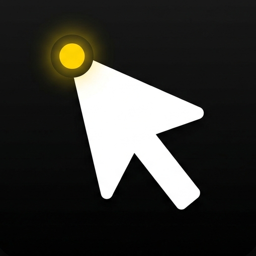

<p align="center">
  
</p>

<h1 align="center">Does your Ctrl+C really work?</h1>

<p align="center">
  A lightweight clipboard feedback tool that shows a visual animation near your cursor<br>
  when you copy (<code>Ctrl+C</code>) or paste (<code>Ctrl+V</code>) content.<br>
  Never wonder again whether your copy actually worked.
</p>

<p align="center">
  
  
  
</p>

## Features

- **Copy Success (Text)** — Yellow indicator dot + expanding panel with scramble-text reveal.
- **Copy Success (Image)** — 120×120 rounded thumbnail with pixel-style reveal animation.
- **Multi-Image Layouts** — Choose the original three-image fan or a four-image horizontal cascade from the tray's compact text selector; the selected mode is remembered.
- **Holding Mode** — Copy feedback stays on screen until `Ctrl+V` is detected or a timeout is reached. It represents a paste-key intent, not a system-wide guarantee that the target app accepted the paste.
- **Parallel Image Loading** — Web images are downloaded concurrently (up to 3 threads), reducing wait time for multi-image clipboard content.
- **Image Exit Animation** — Thumbnail shrinks toward the yellow indicator dot and disappears in sync with text collapse.
- **Web Image Compatibility** — Supports clipboard image extraction from:
  - Direct bitmap (`image/*`)
  - Local file URL/path (`text/uri-list`, `file:///...`)
  - HTML `` (all images extracted, not just the first)
  - `data:image/...;base64` and `http/https` image URL fallback
- **Copy Failed** — Red indicator dot (no valid copied content detected).
- **Paste Success** — Green indicator dot.
- **Silent Mode** — Toggle visual feedback on/off while app keeps running in tray (`Ctrl+Shift+M`).
- **Cursor-bound** — Animation follows your mouse directly, no delay.
- **System Tray Resident** — Background running with quick status and exit control.

<p align="center">
  
</p>

<p align="center">
  
</p>

<p align="center">
  
</p>

## Usage

| Action | Effect |
|--------|--------|
| `Ctrl+C` (with text) | Yellow dot + text panel |
| `Ctrl+C` (with image) | Yellow dot + image thumbnail + stack if multiple images |
| `Ctrl+C` (no selection / unchanged clipboard) | Red dot (copy failed) |
| `Ctrl+V` | Green dot (paste detected) |
| `Ctrl+Shift+M` | Toggle Silent Mode (visual feedback on/off) |
| `Ctrl+Shift+H` | Toggle Holding Mode (dismiss a held copy on `Ctrl+V`) |
| `Ctrl+Shift+Q` | Quit the application |
| Tray image-layout selector (`Fan/Cascade`) | Switch future multi-image feedback between fan and horizontal cascade |
| Right-click tray icon → Exit | Quit the application |

## Quick Start

```bash
cd dose-ctrlc
pip install -r requirements.txt
python main.py
```

If you only want to use it, download the `.exe` from Releases.

## Build

Build instructions and the measured package-size audit are in [docs/PACKAGING.md](docs/PACKAGING.md). Use the checked-in spec: it excludes unused Qt modules/plugins and is the lean reproducible onefile build.

```bash
cd dose-ctrlc
.\.venv\Scripts\python.exe -m PyInstaller --noconfirm --clean DoesCtrlCWork.spec
```

Do not append broad `--collect-all` / `--hidden-import` flags unless a measured missing-runtime error requires them; those flags can undo the spec's size exclusions.

If you use Conda and want to force a specific env:

```bash
conda run -n ctrlc python -m PyInstaller --noconfirm --clean DoesCtrlCWork.spec
```

Output exe location: `dist/DoesCtrlCWork.exe`.

> Note: `keyboard` library requires **Administrator privileges** for global hotkey detection on Windows.  
> Right-click the exe and choose "Run as administrator".

## Documentation

- [Documentation index](docs/README.md)
- [Current technical review and status](docs/planning711/PROJECT_REVIEW.md)
- [Packaging slimming guide](docs/PACKAGING.md)

## Release History

### v2.2.0 — Native Windows Feedback, Cursor Scaling, and Palette Support

This release consolidates the recent Windows interaction, animation, and packaging work.

**Highlights**

- Native rounded tray menu with persistent language/switch settings and better hidden-icons flyout dismissal.
- Cursor-size-aware feedback placement with taskbar-aware bottom docking and smooth screen-edge transitions.
- Fan and horizontal Cascade layouts for multi-image copies, up to four images, with clearer spacing and mirrored edge behaviour.
- Classic dark, Light glass, and Custom palettes for the menu, text panel, image placeholders, and stack surfaces.
- Direct clipboard bitmap feedback with asynchronous file/data-URI/web-image fallback loading.
- Image and placeholder exit animations now shrink and fade in sync with the text feedback.
- Leaner PyInstaller packaging through the checked-in spec and removal of unused assets.

See the complete release notes in [docs/releases/V2.2.0.md](docs/releases/V2.2.0.md).


**Notes**
- For stable builds, package with `python -m PyInstaller` from the intended environment.
- Run as Administrator if global hotkey capture is blocked by system policy.

## Tech Stack

| Language / Framework | Purpose |
|---------------------|---------|
| Python | Core language |
| PySide6 (Qt 6) | GUI framework |
| keyboard | Global hotkey listener |
| PyInstaller | Windows executable packaging |

## File Structure

```text
dose-ctrlc/
├── main.py                   # Entry point: tray + hotkeys + event wiring
├── config.py                 # Animation timing, colors, sizes, params
├── requirements.txt          # Python dependencies
├── app_icon.ico              # Application icon
├── version.txt               # PyInstaller version metadata
├── build.bat                 # Build script
├── core/
│   ├── mouse_tracker.py      # Global cursor tracking + spring physics
│   └── clipboard_monitor.py  # Ctrl+C/V detection + rich clipboard extraction
└── ui/
    └── feedback_widget.py    # Dot/text/image animation lifecycle
```

## License

[MIT](../LICENSE)
