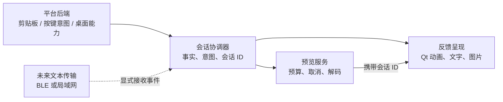

# 跨平台路线与核心逻辑评估

评估日期：2026-11-02。源码基线：`5f4e11d`（最近提交仅改文档，产品源码与 `5bd31d2` 相同）。本轮目标是理解项目、评估跨平台与逻辑优化；蓝牙短文本仅记录为未来设想，没有实现迁移或通信功能。

**结论**

继续使用 Windows 开发完全可行。当前最划算的路线是保留 Python/PySide6 的桌面界面、动画和文本布局，先修好事件会话与后台任务，再将系统接口隔离成平台后端。桌面端追求全局复制反馈；iPhone 端定位为主动分享、收发、复制短文本的配套端。两者共享产品语义及未来消息协议，不要求相同界面或所有代码相同。

当前不能声称已经支持 macOS/Linux/iOS。本轮既有 Windows 离屏测试 81/81 通过；没有其他操作系统、真实 Windows 桌面、iPhone 或 BLE 的现场验收。

**项目和历史的理解**

项目的核心价值是“复制后立即获得可见反馈”。当前没有必要将它扩展成保存全部历史、带账号和云服务的剪贴板管理器。真实运行链是系统剪贴板事件进入 `ClipboardMonitor`，读取文本/图片快照，再由应用编排反馈窗口；Ctrl+C/Ctrl+V 提供按键意图，图片可异步补全，动画和鼠标跟随在活动时才运行。

6 月从鼠标附近的动画原型扩展到图片、多图与 Holding。6 月旧 C++ 混合计划只是设计构想；7 月实际工作解决了状态机、动画时钟、图片缓存和剪贴板事件化，并做过打包瘦身。7 月中旬增加 Windows 原生菜单、光标/DPI、自动隐藏任务栏和边缘停靠；7 月 20–21 日形成现有 raw MIME 优先、长文本视口和独立字体/配色。8 月事实文件汇总了线程和资源风险。

因此，旧审查中“仍靠轮询判断复制”的描述已被源码替代；旧 C++ 计划里“只有热键和 App ID 两个 Windows 绑定点”也不再成立。历史打包体积是当时测量，不能当成本轮构建结果。托盘曾走过自绘弹层、外部轮询、QMenu，再到原生 HMENU 的迭代；应保留这些经验，不重新把 Explorer 行为猜测写进通用 UI。

历史依据：[当前事实（8 月）](CURRENT_PROJECT_FACTS.md)、[历史执行记录](planning711/progress.md)、[归档混合计划](archive/PLAN_CPP_HYBRID.md)、[多图历史](archive/DEVLOG_STACK_FEATURE.md)。

**跨平台究竟能做到什么**

| 平台 | 合理的首版目标 | 需要单独处理的边界 |
|---|---|---|
| Windows | 保留当前复制反馈、鼠标跟随、Holding、托盘和图片体验 | 修复事件乱序、线程与任务关闭；保留 Win32 后端 |
| macOS | 菜单栏驻留、复制反馈，争取接近桌面原体验 | Cmd 快捷键、输入权限、后台剪贴板检测、窗口行为、签名和真机验证 |
| Linux X11 | 先验证文本反馈、托盘与鼠标跟随 | 不依赖 root 键盘监听；区分 CLIPBOARD 和选区；覆盖实际桌面环境 |
| Linux Wayland | 按桌面实际能力提供通知或普通窗口反馈 | 全局剪贴板、鼠标坐标、浮层位置和快捷键需要桌面协议/授权支持；不能承诺 Windows 等效体验 |
| iPhone | 用户主动分享/粘贴到工具、接收文本、点击复制；以后明确发送到电脑 | iOS 后台生命周期、剪贴板隐私与应用沙盒；桌面托盘/全局按键/鼠标浮层不直接适用 |

macOS 有一处容易漏掉：Qt 明确说明，其他应用造成的 `QClipboard.dataChanged` 在本应用激活时才会被检测。因此不能只把 Ctrl 换成 Cmd；后台监控需要单独验证，例如通过原生 `NSPasteboard.changeCount` 做低开销、可调间隔检查，再按变化读取内容。这是适配方案，尚未实施。[Qt QClipboard](https://doc.qt.io/qt-6/qclipboard.html#dataChanged)、[Apple NSPasteboard.changeCount](https://developer.apple.com/documentation/appkit/nspasteboard/changecount)

`keyboard` 上游将 macOS 支持标为实验性，Linux 实现直接读取输入设备且需要 root，按键抑制只支持 Windows。它不宜继续承担所有平台的公共入口。应用命令快捷键和“旁听其他应用的 Ctrl/Cmd+C/V”也应分开；Wayland 的 GlobalShortcuts Portal 可注册用户授权的应用命令，并不等价于通用键盘监听器。[keyboard 上游](https://github.com/boppreh/keyboard)、[GlobalShortcuts Portal](https://flatpak.github.io/xdg-desktop-portal/docs/doc-org.freedesktop.portal.GlobalShortcuts.html)

Wayland 普通顶层窗口通常不能由客户端任意设置全局位置，鼠标事件也以窗口局部坐标提供。由此推断，当前 `QCursor.pos()` 加 `QWidget.move()` 的全屏鼠标追随不能原样成为通用 Wayland 产品承诺；特定 compositor 扩展需另行验证。[Qt 窗口文档](https://doc.qt.io/qt-6/application-windows.html)、[Wayland 协议](https://wayland.freedesktop.org/docs/book/Protocol.html)

iOS 没有通用、无限期后台执行或保证周期 timer 的机制。普通 App 的应用窗口也不能直接作为任意其他 App 上方的桌面浮层。结合剪贴板访问隐私要求，适合本项目的移动端是主动操作的伴侣应用；不能承诺“任意 App 一复制就后台自动捕捉并显示浮层”。通知等系统机制可以另行评估，它们不等于桌面浮窗。[Apple DTS 后台执行说明](https://developer.apple.com/forums/thread/685525)、[Apple 剪贴板隐私](https://developer.apple.com/videos/play/wwdc2022/10096/)、[Apple 运行时安全](https://support.apple.com/en-au/guide/security/sec15bfe098e/web)

需要更新一个旧知识：目前 Qt 6.12 在线文档已列出 `pyside6-ios-deploy`，所以“PySide 完全不能做 iOS”并不准确。但其要求完整 Xcode、iOS 专用 wheels 和签名；当前仓库环境是 PySide6 6.11.1，现有桌面 keyboard/Win32 依赖不会自动变成 iOS 可用。手机端技术栈应在功能范围清晰后，用小型原生能力验证决定，不为复用代码而强搬整个桌面应用。[Qt iOS 部署工具](https://doc.qt.io/qtforpython-6/deployment/deployment-pyside6-ios-deploy.html)

**Windows 开发机与 iPhone 12 mini 如何配合**

日常继续在 Windows 编写和调试共享逻辑。Linux 可用本机虚拟机做桌面验证；WSL 更适合逻辑和构建检查，不能替代所有 Linux 原生桌面行为的验收。自动化可以在 GitHub Actions 的 Windows/macOS/Linux runner 分别运行测试与构建；PyInstaller 并非跨系统编译器，Windows 生成的 exe 不能直接给 Mac 或 iPhone 使用。[GitHub runner](https://docs.github.com/en/actions/reference/runners/github-hosted-runners)、[PyInstaller](https://pyinstaller.org/en/stable/)

不必现在购买 Mac。需要构建 iOS 时，使用能访问到的 Mac 或 macOS CI，完成 Xcode 构建和签名；借用或远程访问 Mac 也有助于调试。CI 能证明构建与部分自动测试，不能证明真实菜单栏、权限弹窗和蓝牙都正常。[Xcode 系统要求](https://developer.apple.com/xcode/system-requirements/)

iPhone 12 mini 的蓝牙硬件足以作为这个短文本设想的测试设备；实际部署目标仍需匹配手机安装的 iOS 和选择的 SDK。手机承担权限、交互、前后台和 BLE 真机测试，不替代 Mac 工具链。若采用 TestFlight 分发，需要相应 Apple Developer Program 成员资格及签名配置；不要把远程构建误解成无需 Apple 配置的一键安装。[设备规格](https://support.apple.com/en-in/111877)、[Apple Developer Program](https://developer.apple.com/programs/)、[TestFlight](https://developer.apple.com/testflight/)

**当前背后逻辑最值得优化的地方**

| 优先级 | 源码与本轮证据 | 应改变的行为 |
|---|---|---|
| 先处理 | `core/clipboard_monitor.py:214/225/258`：先处理剪贴板变更、后处理 Ctrl+C，会先成功后超时报失败；隔离复现确认 | 在钩子入口记录发生时间/事件身份，再交 GUI；用会话关联事实与意图，不按回调到达顺序判断 |
| 先处理 | `core/clipboard_monitor.py:225/240`：新事件成功后旧快照 retry timer 仍可触发；隔离复现产生重复新内容 | 新事件取消旧重试；重试携带事件 ID，过期就丢弃 |
| 先处理 | `main.py:237/246` 与 `ui/feedback_widget.py:561`：图片回包只找当前活动窗口；可投递给后续 Paste 窗口 | 把 `session_id` 贯穿快照、图片任务、signal 和窗口；只更新所属复制会话 |
| 先处理 | `main.py:94`：部分 keyboard callback 直接改 Qt 状态 | 所有外部回调只发语义命令，由 GUI 线程统一处理 |
| 先处理 | `core/clipboard_monitor.py:79`、`main.py:376`：每次请求创建 QThread 和内部线程池，取消不能中断正在阻塞的请求，退出不等待 | 统一有界任务服务、总并发/总 deadline，停止接收结果后执行有界关闭 |
| 紧随其后 | `core/clipboard_monitor.py:313`：普通 HTTP(S) 文本也自动发起请求；文件/data URI/解码未共享预算 | 默认使用剪贴板已有数据；远程预览作为明确设置；统一字节、像素、数量和内存预算 |
| 紧随其后 | `ui/feedback_widget.py:590`：先 copy 再用 cacheKey 去重，两次 copy 的 key 不同；总量只限制单批 | 按稳定 item/source ID 去重；累计数量也遵守预算 |
| 紧随其后 | `main.py:221`：长文本反馈注册裸方向键并 suppress | 换修饰键或显式交互状态，避免操作原应用时被临时截走方向键 |

上表的乱序/重复/错误窗口投递/图片 key 均为进程内隔离复现；尚未测量真实桌面的触发频率。线程和退出项为源码确认的风险，本轮没有诱发崩溃。原有测试通过与这些缺陷并不矛盾：已有测试主要覆盖意图先到、事件后到，以及任务开始前取消，尚未覆盖这些事件排列。

复制事实应与显示状态拆开。建议区分 `ClipboardUpdated`、`CopyIntentObserved`、`CopyUnconfirmed`、`PasteIntentObserved`、`PreviewReady/Failed`。700ms 内没看到新内容，只能说“未确认更新”；Ctrl+V 只能说“检测到粘贴按键”；缩略图下载失败不应推翻剪贴板已经更新的事实。重复复制相同内容也不能单凭内容哈希判失败。这个语义层将来可以复用到其他桌面和跨设备接收。

缩略图解码与缩放可以移到受限后台任务，GUI 只接收小尺寸 QImage，QPixmap 留在 GUI 线程。先通过资源边界和事件跟踪降低工作量，再按测量优化动画时钟；当前 4ms/8ms timer 不等于实际显示帧率，不需要为跨平台继续提高轮询频率。

另有较小但必要的发布修整：日志改 `QStandardPaths` 并轮转；增加单实例；统一 README 与 Windows version 资源；锁定构建依赖。字体候选、Segoe Fluent Icons 和托盘弹出策略应按平台适配。`tests/test_animation_runtime.py:25` 无条件导入 Win32 菜单，部分测试直接 patch `ctypes.windll`，因此 CI 不能只加三系统矩阵，还要区分纯逻辑、平台契约和 Windows 集成测试。

**建议的内部结构**

这只是少量明确边界，不必先建庞大插件系统。平台后端可以从 Clipboard、InputIntent、DesktopGeometry、Tray、Paths 几个接口开始；原生 Windows 实现逐步移入，通用布局只接收可用区域和能力信息。应用命令、任务完成信号和 UI 状态改变统一在受控线程边界内流转。

能力要区分“支持”“需要授权”“不支持”。拿不到全局按键权限时仍可使用剪贴板事件反馈；没有全局坐标时使用可支持的通知或普通窗口；没有托盘时保留设置和退出入口。不要把 `import keyboard` 或热键注册失败变成整个工具无法启动。

**蓝牙短文本设想（后续，不在本轮实施）**

Windows 与 iPhone 通过 BLE GATT 交换小段 UTF-8 文本具有可行性。它适合低频、低带宽交互；Windows 的外围设备角色还取决于适配器能力，应检查 `IsPeripheralRoleSupported`，不能只凭“电脑有蓝牙”判断。初版先约定双方打开工具，选定设备，用户明确发送，接收后点击复制。[Microsoft BLE FAQ](https://learn.microsoft.com/en-us/windows/apps/develop/devices-sensors/bluetooth-dev-faq)、[GATT Client](https://learn.microsoft.com/en-us/windows/apps/develop/devices-sensors/gatt-client)

Apple 支持特定蓝牙后台事件唤醒，但扫描、广播、终止恢复有约束；较新 iOS 又有与 Live Activity 相关的部分延续能力，仍不能推导出任意常驻。尤其不要把“Windows 随时发现后台 iPhone”当作第一版假设，应按手机实际系统和双端角色做实验。[Apple 蓝牙后台指南](https://developer.apple.com/library/archive/documentation/NetworkingInternetWeb/Conceptual/CoreBluetooth_concepts/CoreBluetoothBackgroundProcessingForIOSApps/PerformingTasksWhileYourAppIsInTheBackground.html)、[当前 Core Bluetooth](https://developer.apple.com/documentation/corebluetooth)

现在只需在设计上保留传输边界。未来消息建议含协议版本、message_id、来源设备、UTF-8 正文与长度；设计配对确认、身份校验、加密传输、分片/重组、ACK、去重和过期。不要在广播包内发送正文，也不要让收到的文本自动再次向所有设备转发。先区分“消息已收到”“用户已复制”和“目标应用已粘贴”，避免未来又把不同事实混成一个成功状态。无需现在实现设备发现、账号或持久队列。

**推荐实施顺序与完成条件**

第一轮聚焦现有 Windows 可靠性：会话关联、旧 retry 失效、所有快捷键 GUI bridge、图片回包归属和任务关闭。完成条件是乱序和连续复制/粘贴场景通过，并且既有 81 项无回归，真实退出与菜单行为再验收。

第二轮提取平台接口和能力降级，保持 Windows 行为；固定依赖、版本和日志路径，整理平台测试并建立三系统构建。完成条件是没有 Windows-only import 阻断其他系统，禁用输入监听后基础工具仍能启动运行。

第三轮选择一个桌面平台实测，产品上建议优先 macOS；若暂时没有 Mac 测试渠道，可先用 Linux X11 虚拟机验证边界拆分，再验证 macOS。Wayland 单列能力范围。构建通过不能标记为完整支持。

第四轮再定手机端的主动交互原型与技术栈，让 iPhone 12 mini 验证实际体验；最后做双方前台的 BLE 短文本概念验证。暂不承诺后台全自动同步，更不以蓝牙设想迫使当前 UI 全量重写。

**本轮验证与交付边界**

环境：Python 3.14.4、PySide6 6.11.1、keyboard 0.13.5。执行 `QT_QPA_PLATFORM=offscreen` 下的 `.venv/Scripts/python.exe -m unittest discover -s tests -v`，81 项通过，用时 2.481 秒。日志：[unittest.log](../.planning/2026-11-02-cross-platform/unittest.log)。隔离缺陷复现脚本与日志保存在同一分析目录。

本轮只新增评估与分析材料、更新文档入口；没有修改产品代码，没有新构建安装包，没有运行真实系统热键/蓝牙联调，也没有提交或推送 Git。
